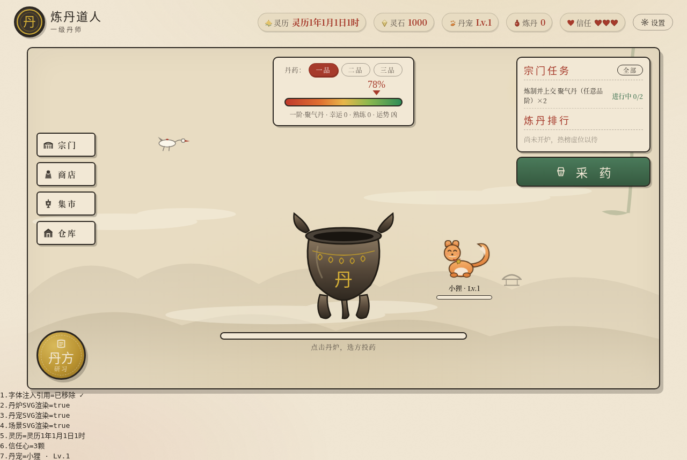

# 炼了个丹

一款纯前端**水墨仙侠风炼丹网页游戏**。零依赖、零构建、零网络请求——所有画面均由手绘 SVG 与系统字体本地渲染，`index.html` 打开即玩，完全断网也可运行。



## 快速开始

```bash
# 方式一：直接打开
双击 index.html 即可游玩

# 方式二：本地服务（推荐）
python3 -m http.server 8642
# 浏览器打开 http://127.0.0.1:8642
```

存档自动保存在浏览器 localStorage（每秒落盘），关闭页面进度不丢失。

## 界面布局

| 区域 | 内容 |
|---|---|
| 顶栏 | 头像（点击查看丹师简介）、灵历/灵石/丹宠/炼丹/信任心、**设置**（手札/成就/玩法/音效/重修） |
| 顶部中央 | 炼丹成功率仪表（红绿渐变条 + 倒三角指针，可切换品级查看） |
| 左侧竖排 | 宗门 / 商店 / 集市 / 仓库 四大入口 |
| 中央 | 青铜丹炉（三步开炉）、炉顶悬浮丹药（点击收取）、丹宠小狸 |
| 左下 | 丹方圆钮（丹方图鉴，按凡/灵/圣/神四品分类） |
| 右侧 | 宗门任务摘要 + 炼丹排行 + 「采药」按钮 |
| 中下端 | 实时提示条（手札消息，自动消失） |
| 底部左下 | 修行手札历史可在设置中查看 |

## 核心玩法循环

```
采药/买料 → 投药 → 确定 → 炉底选柴 → 点火熬制
   ↓                                    ↓
 灵石 ← 集市卖丹 ← 收取炉顶丹药 ← 出丹（品阶随机 + 品级判定）
   ↓
 商店：购稀有材料 / 研习新丹方 / 升级丹炉 / 购自动采药符
   ↓
 宗门：完成每日委托 → 俸禄 + 贡献 + 信任心 → 晋升官阶 → 更高阶委托
   ↓
 丹师境界：修为累积 → 突破境界 → 解锁更高阶委托与酬劳
```

## 炼丹系统详解

### 三步开炉

1. **投药**：点丹炉选丹方，投入所需药材，齐备后点「确定」
2. **选柴**：点炉底柴堆挑木柴——柴薪（寻常火候）/ 灵木（成功率 +8%，高品级产出 ×1.5）
3. **点火**：开始熬制，期间点丹炉可扇火提速

### 五等品阶 × 三品品级

每次炼成先判定品级（一品/二品/三品，火候极佳时直接炼出高品级），再判定品阶（凡/良/上/极/仙）。仙品稀有且价值最高。产出的丹药会从炉中缓缓升起悬浮于炉顶，点击收取入仓库。

### 丹药花纹（随丹方阶数）

| 阶数 | 花纹 |
|---|---|
| 一阶 | 一道纹 |
| 二阶 | 两道纹 |
| 三~五阶（灵品） | 浅色丹气环绕 + 1~3 道纹 |
| 六~八阶（圣品） | 镶嵌玉石 + 黄色丹气 + 1~3 道玉纹 |
| 九~十阶（神品） | 丹灵 + 紫色丹气 + 1~2 道纹 |

### 丹方总表（十阶十九种）

| 阶 | 丹名 | 品级 | 底价 | 药性 |
|---|---|---|---|---|
| 一 | 聚气丹 | 凡 | 30 | 采药产量 ×2 |
| 二 | 筑基丹 | 凡 | 70 | 炼丹成功率 +5% |
| 二 | 小还丹 | 凡 | 60 | 炼丹成功率 +3% |
| 三 | 培元丹 | 灵 | 140 | 炼丹不累积心火 |
| 三 | 清灵丹 | 灵 | 160 | 高品级产出 ×1.2 |
| 四 | 凝金丹 | 灵 | 260 | 集市售价 +30% |
| 四 | 淬体丹 | 灵 | 300 | 采药产量 ×1.5 |
| 五 | 养神丹 | 灵 | 450 | 炼丹不累积心火 |
| 五 | 凝婴丹 | 灵 | 520 | 集市售价 +50% |
| 六 | 化神丹 | 圣 | 800 | 炼丹成功率 +10% |
| 六 | 破障丹 | 圣 | 950 | 炼丹不累积心火 |
| 七 | 炼虚丹 | 圣 | 1400 | 高品级产出 ×1.5 |
| 七 | 玄冥丹 | 圣 | 1600 | 炼丹成功率 +6% |
| 八 | 合体丹 | 圣 | 2400 | 集市售价 +60% |
| 八 | 天心丹 | 圣 | 2700 | 高品级产出 ×1.8 |
| 九 | 渡厄丹 | 神 | 4000 | 炼丹成功率 +8% |
| 九 | 太乙丹 | 神 | 4500 | 集市售价 +100% |
| 十 | 飞升丹 | 神 | 7000 | 采药产量 ×3 |
| 十 | 造化丹 | 神 | 8000 | 采药产量 ×4 |

> 「药性」为服用丹药触发的限时增益，品级越高持续越久（二品 ×1.5、三品 ×2 时长）。

### 炼丹变量机制

- **心火**：炼成后 60% 概率累积 1~3 点，每点 -1% 成功率；跨日打坐清零；服用培元丹/养神丹/破障丹可免疫或清除
- **熟练度**：同一丹方每炼成 5 枚 +1% 成功率（上限 +10%）
- **幸运值**：服用丹药累积，每点 -0.5% 失败率并小幅提升高品阶概率
- **炼丹异象**：点火后 40% 概率触发抉择事件（小狸扒炉 / 心魔低语 / 雷雨骤至 / 灵气涌动），取舍影响本炉成败与品级
- **木柴**：灵木可使成功率 +8%、高品级产出 ×1.5

## 材料一览（11 种）

| 材料 | 属性 | 价格 | 主要来源 |
|---|---|---|---|
| 灵草 | 木属·性平 | 10 | 采药（高概率）/ 宗门配发 |
| 火晶石 | 火属·性烈 | 25 | 采药 / 商店 / 宗门配发 |
| 紫猴花 | 紫属·性平 | 35 | 采药 / 商店 / 宗门配发 |
| 黄龙芝 | 黄属·性温 | 45 | 采药 / 商店 / 宗门配发 |
| 雪莲 | 冰属·极寒 | 60 | 采药（低概率）/ 商店 / 宗门配发 |
| 地髓草 | 土属·性厚 | 90 | 采药（低概率）/ 商店 |
| 龙涎草 | 龙属·至阳 | 120 | 采药（低概率）/ 商店 |
| 灵乳 | 乳白·性润 | 150 | 商店 / 宗门配发（高官阶） |
| 天心莲 | 天属·性清 | 260 | 商店 / 宗门配发（高官阶） |
| 凝魂草 | 魂属·性幽 | 320 | 商店 / 宗门配发（高官阶） |
| 柴薪 / 灵木 | 燃料 | 8 / 60 | 采药拾得 / 商店（点火消耗） |

## 丹师境界（十重）

炼成丹药、完成委托、达成成就均累积**修为经验**。境界越高，宗门委托的丹药品阶、数量与酬劳随之上调。

| 境界 | 所需累计修为 | 丹师品衔 |
|---|---|---|
| 练气期 | 0 | 一品丹师 |
| 筑基期 | 80 | 二品丹师 |
| 金丹期 | 220 | 三品丹师 |
| 元婴期 | 480 | 四品丹师 |
| 化神期 | 900 | 五品丹师 |
| 炼虚期 | 1500 | 六品丹师 |
| 合体期 | 2400 | 七品丹师 |
| 大乘期 | 3700 | 八品丹师 |
| 渡劫期 | 5400 | 九品丹师 |
| 飞升期 | 7600 | 十品丹师 |

修为来源：炼成丹药（阶数 ×5 ×品级倍率）、完成每日委托（+30）、达成成就（奖励的 1/10）。

## 宗门系统

- **每日配发**：每个灵历日发放固定药材包（随官阶五档递进）与柴薪×2
- **每日委托**：张贴一件委托（用配发药材炼丹上交等），难度与酬劳跟随丹师境界
- **跨日结算**：完成 → 全额俸禄 + 恢复一颗信任心；未完成 → 俸禄扣半 + 失去一颗信任心
- **信任心**：三颗，扣至零则**执法堂斩立决**（游戏结束，转世重修）
- **官阶**：外门弟子 → 内门弟子 → 真传弟子 → 客卿长老 → 太上长老（贡献累积晋升，俸禄 50~800 石逐级上调）

## 其他系统

- **丹宠小狸**：炼丹涨经验，升级提升高品阶概率；偶尔叼回药材；点击可戳
- **集市行情**：售价随行情波动（×0.85~1.15，每 30 秒刷新）
- **丹炉四阶**：铁炉 → 文火炉（耗时 -30%）→ 紫金炉（品阶 +8%）→ 八卦炉（品阶再提升）
- **灵历时间**：随操作耗时推进（采药 1 时辰、开炉更多），12 时辰 = 1 日，30 日 = 1 月，12 月 = 1 年
- **成就**：10 项成就（首炼 / 百炼 / 仙品 / 三品 / 福缘 / 贡献 / 仓廪 / 灵历一年等），达成即得灵石
- **自动采药符**：购买后每 6 秒自动采药，离线也持续（不推进灵历，上限 2 小时）

## 文件结构

```
index.html    页面结构 + 手绘 SVG（场景/丹炉/丹宠/图标）
style.css     水墨仙侠风样式与动画（纯本地，无网络字体）
js/game.js    全部游戏逻辑与 localStorage 存档
README.md     本说明
```

## 技术说明

- **零依赖**：无任何第三方库、无网络请求、无外部字体——全部画面为手绘 SVG + 系统字体栈（楷体/宋体），断网运行效果完全一致
- **存档**：localStorage 自动落盘；「设置 → 散功重修」或信任心耗尽转世重修可清档
- **兼容性**：现代浏览器（Chrome/Edge/Firefox/Safari）均可运行，响应式适配窄屏

## 已知边界

- 游戏时间随操作推进，挂机不推进灵历（自动采药符的离线收益除外）
- 炼制失败损失药材属设计机制，可用灵木/增益/熟练度对冲
- 存档保存在浏览器本地，清除浏览器数据会丢失进度